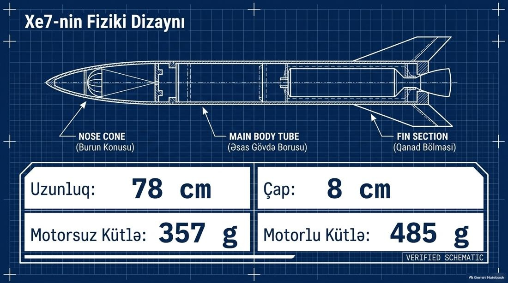
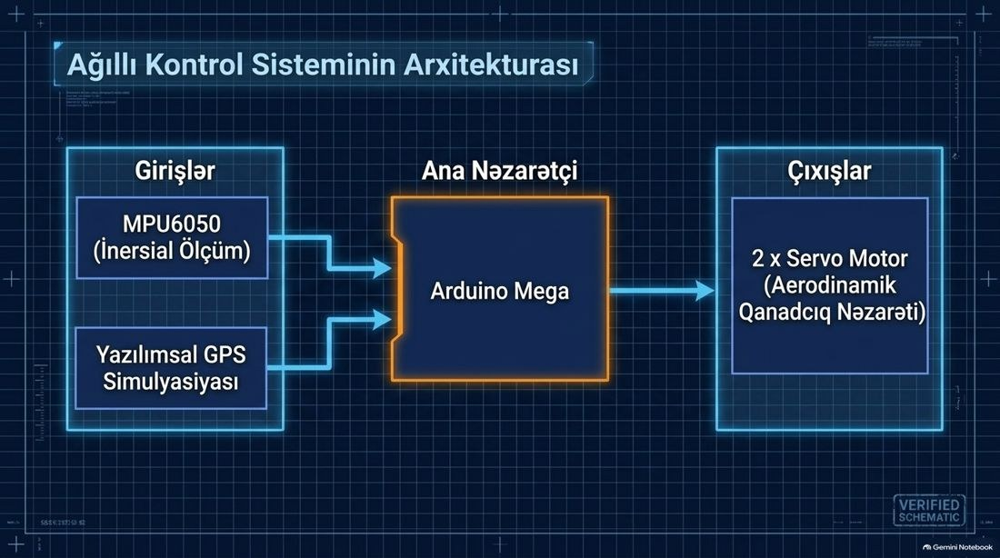
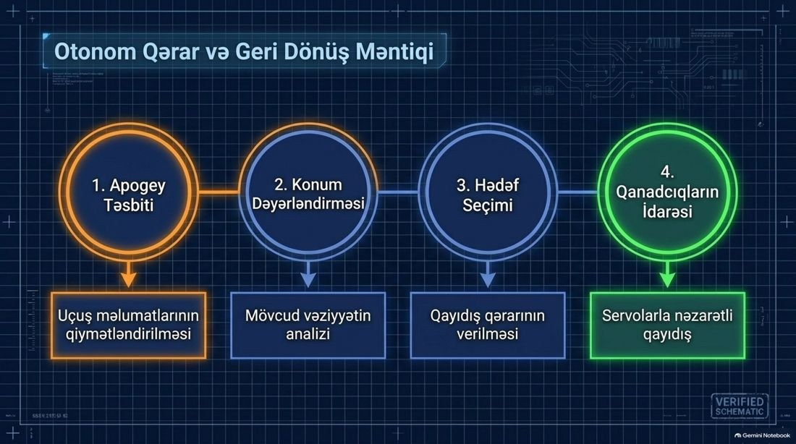
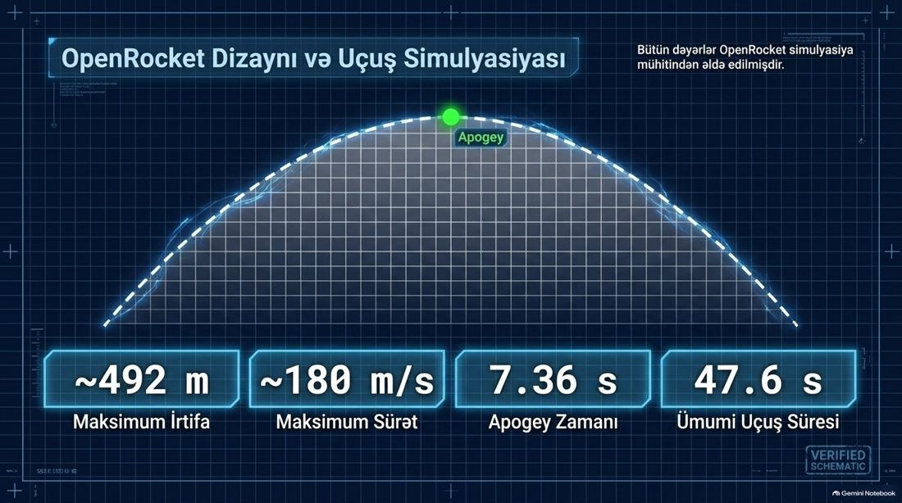
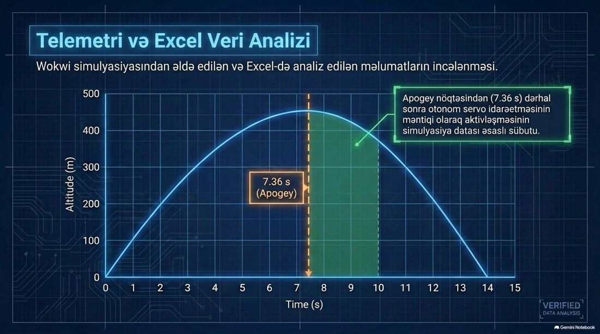
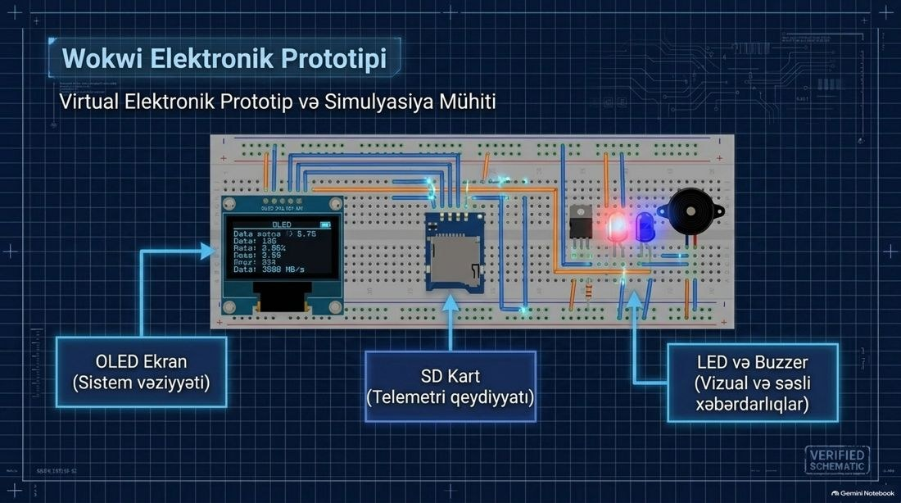

# Xe7 — Autonomous Rocket Flight Computer

**3rd place (out of 7 finalists) — AzRoksan Rocket Technologies Competition, 2026**

Xe7 is a model-rocket flight computer concept that uses servo-driven aerodynamic fins to steer the rocket back to a safe landing zone instead of drifting with the wind. I designed the rocket, the electronics, the firmware and the simulations myself. The current stage is a **virtual prototype** (OpenRocket + Wokwi); physical flight tests are the next step.



## Key figures

| Item | Value | Source |
|---|---|---|
| Length / diameter | 78 cm / 8 cm | OpenRocket model |
| Mass (without / with motor) | 357 g / 485 g | OpenRocket model |
| Static stability margin | 1.3 cal | OpenRocket model |
| Apogee | ~492 m at 7.36 s | OpenRocket simulation |
| Control loop period | 100 ms | firmware (`delay(100)`) |
| Telemetry logging | 8-field CSV every 500 ms (2 Hz) to SD card and serial | firmware |

> All flight numbers are **simulation results**, not measured flight data.

## System architecture



| Block | Part | Interface |
|---|---|---|
| Controller | Arduino Mega 2560 | — |
| Inertial sensor | MPU6050 (accelerometer + gyroscope) | I2C |
| Data logging | microSD card module | SPI |
| Display | SSD1306 OLED 128×64 | I2C |
| Actuators | 2 × servo (pitch / roll fins) | PWM |
| Recovery outputs | drogue + main parachute pins (reserved) | digital out |
| Status | RGB/LEDs, buzzer, ARM switch | GPIO |

In the Wokwi prototype the GPS position is **software-simulated** and the altitude follows the OpenRocket flight profile.

## Flight logic



1. **Ready / ARM** — system waits for the ARM switch.
2. **Ascent** — telemetry logging starts.
3. **Apogee** — detected at the apogee time of the flight profile (7.36 s); descent mode starts.
4. **Position evaluation** — distance and bearing to the selected landing target are computed.
5. **Target selection** — if the primary target is unsafe, the nearest safe alternative is chosen (3 predefined targets).
6. **Fin control** — above 150 m: autonomous return guidance; at 150 m and below: controlled final approach.
7. **Landing** — servos centred, recovery outputs off.

## Simulation and analysis

| OpenRocket flight simulation | Telemetry analysis (Excel) |
|---|---|
|  |  |

IMU calibration was done through repeated test runs; results were logged and compared in Excel.

## Wokwi virtual prototype



Run it online: **https://wokwi.com/projects/474497543825711105**

## Repository layout

```
firmware/xe7_flight_computer/   Arduino firmware (.ino)
wokwi/                          Wokwi circuit (diagram.json) and library list
openrocket/                     OpenRocket rocket model (.ork)
docs/images/                    Figures from the competition presentation
```

Required Arduino libraries: Servo, Adafruit GFX, Adafruit SSD1306, Adafruit MPU6050, Adafruit Unified Sensor, SD.

## Next steps

- Physical flight tests and sensor-based apogee detection (replacing the time-based profile)
- Real GPS module instead of the simulated position
- Custom PCB (KiCad) for the flight computer

---

### Türkçe özet

Xe7, servo kontrollü aerodinamik kanatçıklarla roketi güvenli iniş bölgesine yönlendirmeyi amaçlayan bir uçuş bilgisayarı konseptidir. AzRoksan Roket Teknolojileri Yarışması'nda 7 finalist arasında 3. oldu. Tasarım, elektronik, yazılım ve simülasyonları kendim yaptım. Proje şu an sanal prototip aşamasındadır (OpenRocket + Wokwi). Tablodaki uçuş değerleri simülasyon sonuçlarıdır.

**Author:** Emin İsmayılov — Electrical & Electronics Engineering, Recep Tayyip Erdoğan University · [LinkedIn](https://www.linkedin.com/in/cr-emin-ismayilov)
